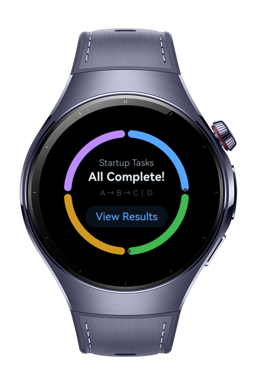
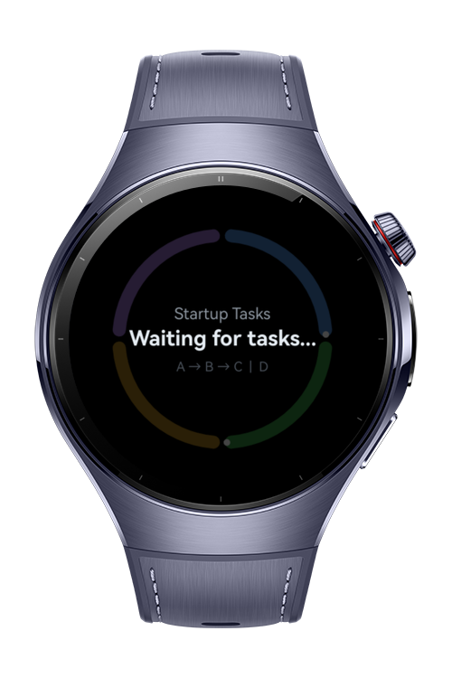
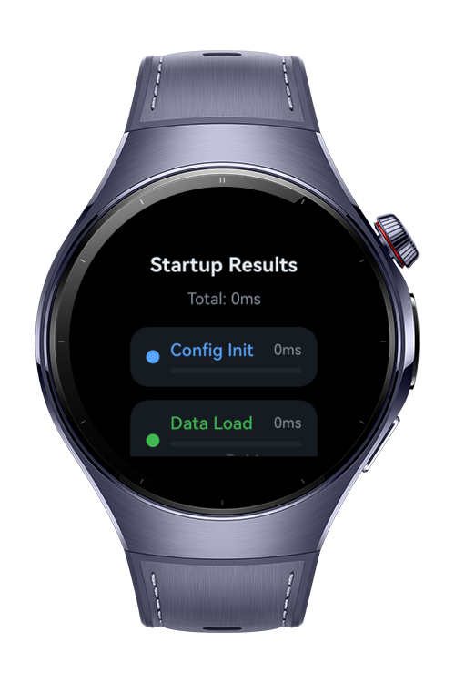

> **Note:** To access all shared projects, get information about environment setup, and view other guides, please visit [Explore-In-HMOS-Wearable Index](https://github.com/Explore-In-HMOS-Wearable/hmos-index).

# How to Build Startup Recovery Board

This HarmonyOS Codelab demonstrates the App Startup framework on a wearable app.
It visualizes startup execution as a circular task board, including dependency order and parallel task behavior.
Users can watch TaskA -> TaskB -> TaskC run in sequence while TaskD runs independently, then open a summary view with per-task duration and total startup time.
It helps developers understand startup orchestration, task result retrieval, and timing analysis in a compact watch UI.

# Preview

<div>
  
  
  
</div>

# Use Cases
- Startup dependency visualization: Demonstrate a chained execution path (TaskA -> TaskB -> TaskC) and an independent parallel task (TaskD).
- Startup performance review: Track each task duration and view total startup wall-clock time in a summary panel.
- Startup framework learning: Understand `StartupTask`, `StartupConfigEntry`, `StartupListener`, and `startupManager.getStartupTaskResult()` usage in a real wearable sample.

# Technology

## Stack
- **Languages**: ArkTS, ArkUI
- **Frameworks**: HarmonyOS SDK 6.0.1(21), App Startup framework
- **Tools**: DevEco Studio (HarmonyOS NEXT toolchain), Hvigor
- **Libraries**:
    - `@kit.ArkUI`
    - `@kit.AbilityKit`
    - `@kit.BasicServicesKit`
    - `@kit.CoreFileKit`
    - `@kit.PerformanceAnalysisKit`

# Directory Structure

```
entry/
|-- src/main/ets/
|   |-- entryability/
|   |   `-- EntryAbility.ets
|   |-- entrybackupability/
|   |   `-- EntryBackupAbility.ets
|   |-- pages/
|   |   `-- Index.ets
|   `-- startup/
|       |-- MyStartupConfig.ets
|       |-- TaskA.ets
|       |-- TaskB.ets
|       |-- TaskC.ets
|       `-- TaskD.ets
|-- src/main/resources/base/profile/
|   |-- backup_config.json
|   |-- main_pages.json
|   `-- startup_config.json
`-- src/ohosTest/
    `-- ets/test/
```

# Constraints and Restrictions
## Supported Devices
- HarmonyOS wearable devices (for example, Huawei Watch series)
- DevEco Studio Wearable Simulator

# License

**How to Build Startup Recovery Board on Watch** is distributed under the terms of the **MIT License**.

- See the [LICENSE](LICENSE) for more information
